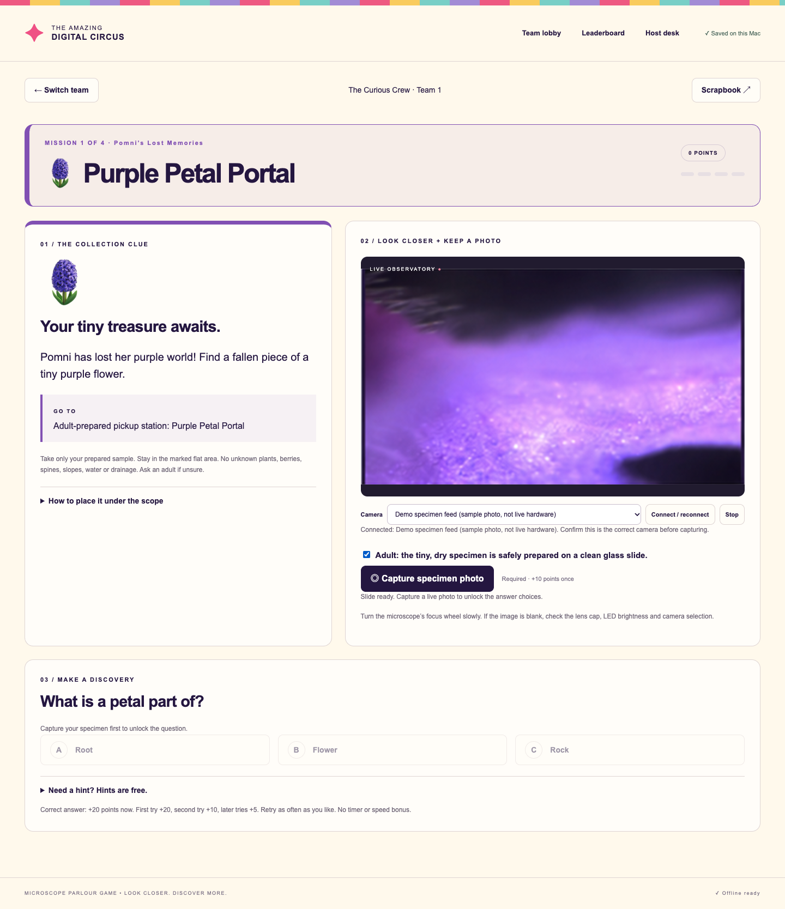
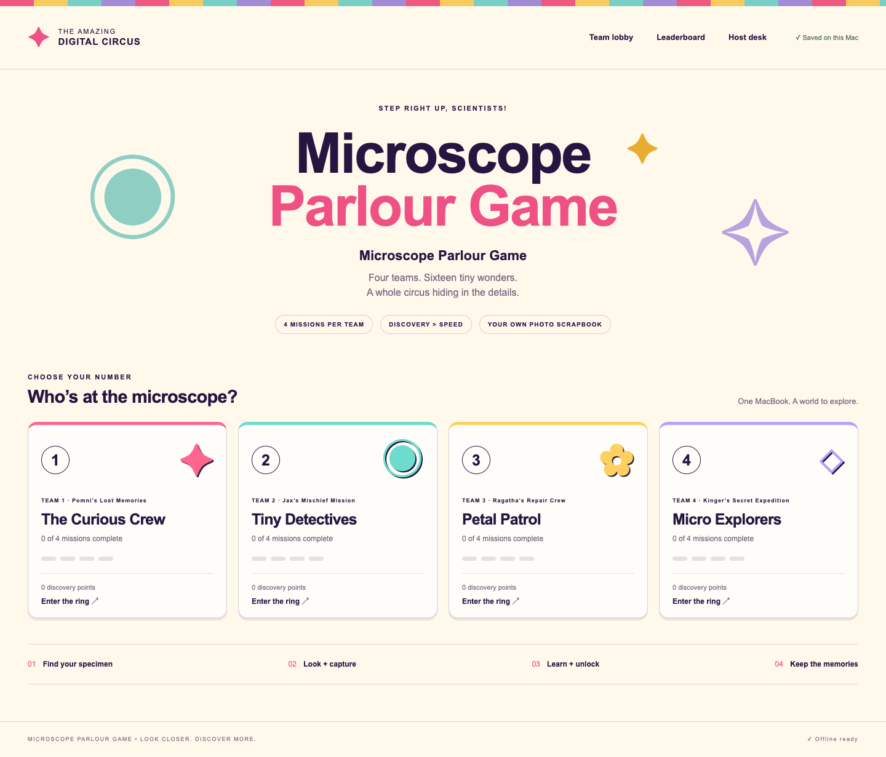
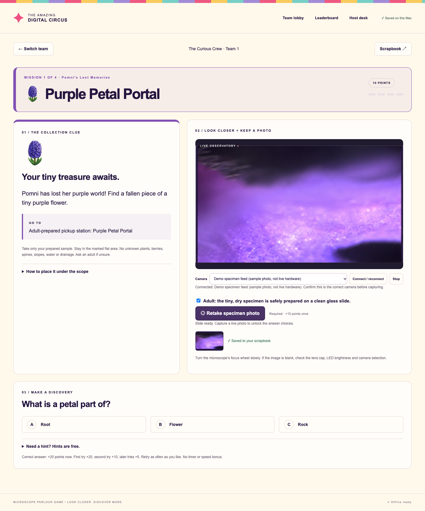
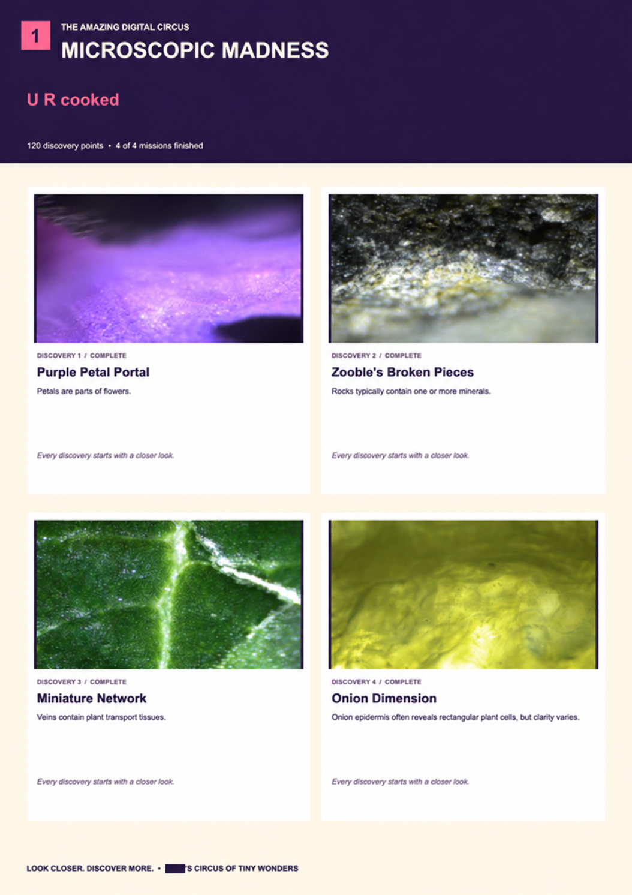

# Microscope Parlour Game

**Do you have kids or fun friends? Got a microscope collecting dust?**

A microscope is full of possibilities, but “let’s look at something” can run out of steam. Give your party a reason to gather around it: a clue to follow, something surprising to discover, and a little friendly competition.

**Microscope Parlour Game** is an unofficial **The Amazing Digital Circus (TADC)-themed** parlour game that makes it fun for your party to use your microscope. Teams collect simple specimens, take turns looking closer, snap photos, and answer questions. Everyone leaves with a photo scrapbook of the tiny world they explored together.

The included game has four teams and 16 missions. Play it at a birthday, with friends, or around the kitchen table. An adult hosts and prepares safe samples; discovery matters more than speed.

## See it in the browser

The clue and microscope image sit side by side in the web app. Choose your camera, focus the specimen, and capture a photo without leaving Chrome.



*Screenshot of the running app. The camera panel uses a labeled demo feed made from the example specimen photo; no physical microscope was connected for these screenshots. With a compatible microscope connected, this same panel shows its live camera feed.*

<details>
<summary>Team lobby and the photo-to-quiz flow</summary>

### Choose a team

Four teams have their own mission sequence, name, score, and progress.



### Capture, then answer

Taking a specimen photo saves it to the team scrapbook, earns discovery points, and unlocks the multiple-choice question below.



</details>

## A keepsake from your party

Each team can download a high-resolution PNG scrapbook to print or share, with its microscope photos, discoveries, and score. Here’s an example from the original party version; the team photo and personal birthday details have been redacted. This example retains the original game’s title and theme.

<a href="docs/images/example-scrapbook-redacted.png"></a>

## What you need

A computer with Google Chrome and Python 3, a microscope that Chrome can use as a camera, a few safe specimens, and some curious people. Everything runs locally: no account or uploads, and photos stay in your browser. Once the files are cached, you can play without Wi-Fi while the local server stays running.

## Quick start

Install Python 3 and Google Chrome, download this repository, then run from its folder:

```sh
python3 server.py --no-open
```

Open **http://localhost:8765** in Chrome. On Windows, use `py -3 server.py --no-open` if `python3` is unavailable. The optional **Launch Party.command** shortcut opens Chrome on macOS. Do not open `index.html` directly.

## Microscope options

Already have one? Try it in practice mode first. The key is whether it appears in Chrome’s camera selector—not its brand or the magnification on the box.

These are **candidates based on manufacturer documentation**, not models tested with this game. Confirm compatibility with your computer and try a real capture before your party.

| | Microscope | Why it is a candidate |
| --- | --- | --- |
| <a href="https://plugable.com/products/usb2-micro-250x"></a> | **[Plugable USB2-MICRO-250X](https://plugable.com/products/usb2-micro-250x)** — a straightforward option for a party | Plugable documents a webcam chipset, standard webcam software support, built-in lighting, and an included stand. [Manufacturer details](https://plugable.com/products/usb2-micro-250x). |
| <a href="https://www.dinolite.us/products/usb-microscopes/af7515mztl/"></a> | **[Dino-Lite AF7515MZTL](https://www.dinolite.us/products/usb-microscopes/af7515mztl/)** — a higher-end option if you already own one | Dino-Lite lists USB 2.0 and UVC imaging, plus Windows/macOS support. Use the wired USB connection; its optional Wi-Fi module is not integrated with the game. Advanced vendor features are not controlled by the game. [Manufacturer specifications](https://www.dinolite.us/products/usb-microscopes/af7515mztl/). |

Product photos are served from the manufacturers’ websites, link to their product pages, and remain their respective owners’ property. The Dino-Lite photo shows the model family. Links are not affiliate links. A basic compatible USB microscope is enough; premium equipment is optional.

## Compatible microscopes

Compatibility is based on camera access, not brand or advertised magnification. **No physical microscope models have been verified for this release.**

| Microscope type | Compatibility |
| --- | --- |
| USB digital microscope that appears as a standard camera in Chrome (typically UVC/webcam compatible) | Expected to work if the operating system and Chrome can access its video feed; test your exact model. |
| Optical microscope with a USB eyepiece camera or camera adapter | Expected to work if that camera appears in Chrome. The app connects to the camera, not the optical microscope. |
| Optical microscope without a camera | Cannot capture directly; add a compatible camera adapter. |
| HDMI-only microscope | No direct connection; requires a capture device exposed to Chrome as a camera. Untested. |
| Wi-Fi/app-only or proprietary-driver-only microscope | No direct support unless its feed is exposed as a normal camera to Chrome. |

Use desktop Chrome as the reference browser. Other browsers and mobile devices are unverified. There are no vendor SDK integrations, motor controls, autofocus controls, or magnification calibration.

**Before your event:** connect the microscope, close other camera apps, start practice mode, allow camera access, refresh the camera list, select the microscope, and capture a focused specimen photo. Check the scrapbook export too. A built-in webcam can test the workflow but is not a substitute for microscope magnification.

The camera API requires permission and a secure context; localhost qualifies. See [MDN’s camera API documentation](https://developer.mozilla.org/en-US/docs/Web/API/MediaDevices/getUserMedia).

## Customize and contribute

Edit `missions.js` for specimens, clues, preparation, questions and explanations. `config.js` contains game settings; some theme and display text also lives in `app.js` and `index.html`. The host desk can edit unused missions without code. Always check and approve pickup locations before play.

The included circus character references are fan-themed text. This project is unaffiliated with or endorsed by The Amazing Digital Circus or its creators. The MIT license covers this project’s code; it grants no rights to third-party names, characters or trademarks. No third-party character artwork is bundled. Replace the themed text for your own event.

Bug reports and contributions are welcome. For hardware reports, include the exact microscope/camera model, operating system, Chrome version, whether it appears in the camera selector, and whether capture works. Do not include children’s photos or personal information.

## License

[MIT](LICENSE) — copyright 2026 Neema Moraveji.

## Launch and prepare

1. Double-click **Launch Party.command** in Finder. It opens Chrome at **http://localhost:8765**. Keep the original server window open. Launching again reopens the running app; the extra window can be closed.
2. If updating an already-open copy, refresh Chrome, wait a few seconds, then refresh once more. You should see the four character themes below.
3. Open **Host desk → I’m the adult host**. Generic adult-prepared pickup stations are prefilled. Walk through them, verify safe plant identification and access, and adjust any locations that need a prepared substitute. Approve the collection area only after the actual checks.
4. Each team selects its number and enters a custom name. The character theme is a mission sequence, separate from its chosen team name.
5. An adult handles the glass and prepares a tiny, flat, dry specimen on a clean slide. Check the slide-ready box, select the USB microscope and connect. Capture a real camera photo to unlock the current multiple-choice question.
6. A correct answer saves progress, shows confetti, and reloads at the next clue for the same team, at the top of the page. Reconnect the camera when the team returns with its next specimen. After mission 4, take or upload a group photo and export the branded 2400 × 3400 PNG scrapbook.

| Team / theme | Mission 1 | Mission 2 | Mission 3 | Mission 4 |
| --- | --- | --- | --- | --- |
| 1 — Pomni’s Lost Memories | 🪻 Purple Petal Portal | 🧩 Zooble's Broken Pieces | 🍃 Miniature Network | 🧅 Onion Dimension |
| 2 — Jax’s Mischief Mission | 🤍 White Disguise | 🍂 Forgotten Forest | 🌾 Golden Hair | 🧂 Crystal Confusion |
| 3 — Ragatha’s Repair Crew | 🩶 Silver Glitch | 🎗️ Green Ribbon | 🪨 Royal Pebble | 🧵 Thread of Reality |
| 4 — Kinger’s Secret Expedition | 🍁 Red Glitch | ☀️ Green Power Chip | 🟨 Final Golden Thread | 🧻 Paper Portal |

## Scoring

Each first specimen photo earns 10 points. Correct answers earn 20 on the first attempt, 10 on the second, and 5 on later attempts. Maximum: 120 per team. Hints are free. Incorrect answers keep earned photo points and reveal a hint. Retaking a photo does not add points. No race timer or speed bonus; ties share a rank.

## Test before the party

Use **Test at the lab / Start practice mode** to test with adult-prepared specimens without approving collection locations. Practice photos and scores are separate. Check slide ready, connect the actual microscope, capture a photo, and answer. Confirm confetti and the new mission’s emoji/color appear. Run one team through all four missions, add a group photo, and inspect its downloaded PNG. Reload and check progress. Once **Offline ready** appears in the footer, turn off Wi-Fi and reload while leaving the server running. Return to party mode afterward.

## Adult controls

Host desk can approve an unclear answer after a real photo, skip a mission, pause collection, and reset a team or the entire current set. Skip awards no answer points. Reset permanently removes that current record’s images and progress and requires confirmation.

**Edit or replace an unused challenge** lets the host change its title, location, clue, preparation, three answer options, correct answer, hint and explanation. Photographed or attempted challenges are locked to protect their scrapbook records. Saving an edit pauses collection until pickup locations are reviewed and approved again. Prepare replacements before play when possible.

## Microscope and safety

Adults approve all natural specimens and level, accessible collection zones. Keep children away from cactus, agave, sharp yucca, unknown berries, irritating plants, drainage, steep slopes, retaining walls and traffic. Never climb, reach across sharp plants or damage living trees. Only take fallen material unless an adult approves picking. Ornamental grasses must be soft and free of sharp edges or barbed seed awns; otherwise use an adult-provided substitute. Adults select tiny, blunt rock grains without breaking or chipping rocks. No tasting; wash hands afterward.

Adults handle slides. Start at 4x where the microscope has labeled objectives; a USB scope without objectives uses its widest clear view. Use 10x only where the mission permits it and an adult approves. Tiny gravel and Royal Pebble are 4x only. Keep thick objects away from the lens. Never put loose specimens directly on the stage or use 40x on uncovered samples.

Onion Dimension uses a transparent membrane. The default is dry. If an adult chooses its optional water drop, use a suitable coverslip and keep it away from the lens. This safety clarification preserves the earlier rule against wet mounts without suitable coverslips. Questions do not require visible cells, pollen or microbes. The microscope image does not establish an exact plant species.

## Saved data and the imported set

The supplied missions use a new saved record, so old images cannot be mistaken for different specimens. Existing custom team names and group photos carry forward. Mission progress begins fresh and locations need adult approval. Previous party/practice records remain stored separately; **Host desk → Previous challenge scrapbooks** can export their team PNGs under the original specimen labels.

Continue using the same Chrome profile and **http://localhost:8765**. Incognito, another hostname or port, and clearing site data can prevent access to existing records. Request persistent storage in Host desk if desired, and download the PNG keepsakes before clearing anything. Camera capture requests video only. Team photos can also be uploaded; if HEIC fails, convert to JPEG or PNG.

## Files

- **HOST-GUIDE.md**: complete mission list, preparation notes and answer key.
- **TEST-REPORT.md**: checks and verification limits.

If double-click launch does not work, open Terminal, type `cd `, drag this folder in, press Return, and run `python3 server.py`. This Mac needs Python 3 and Chrome; no other packages or internet access are required. Do not open index.html directly.
